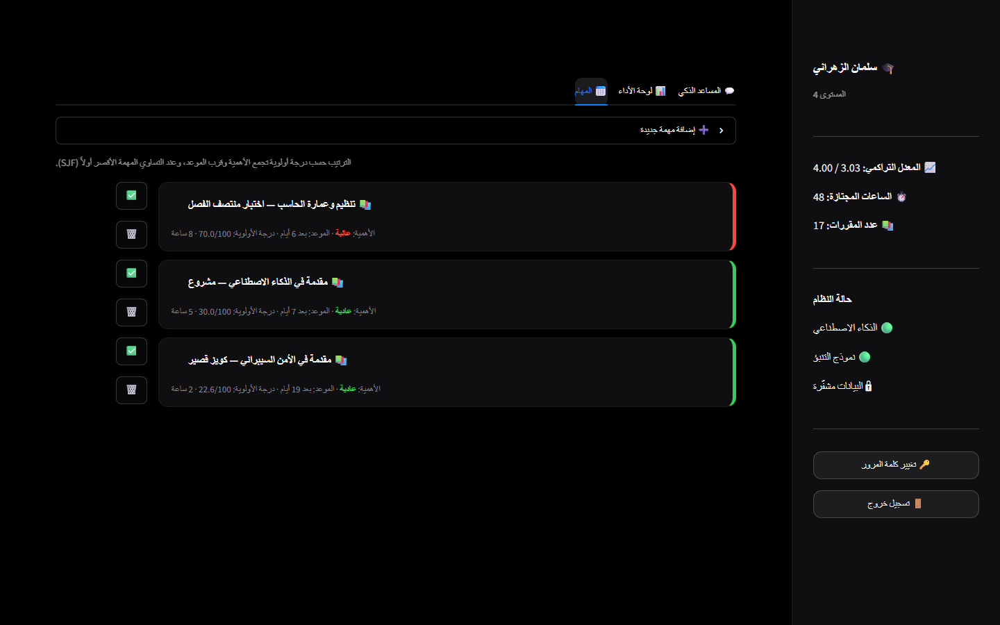
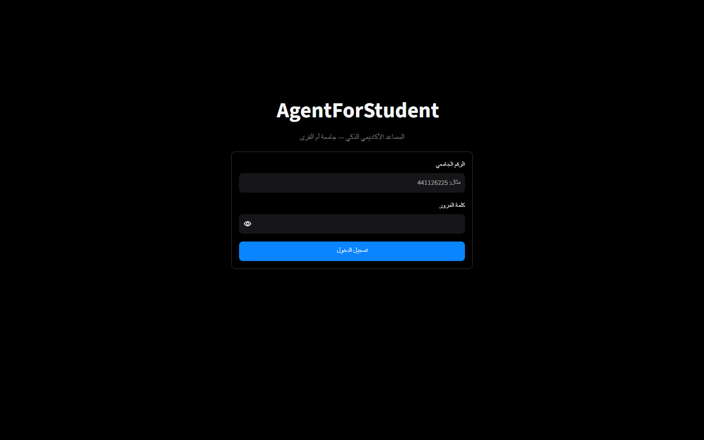
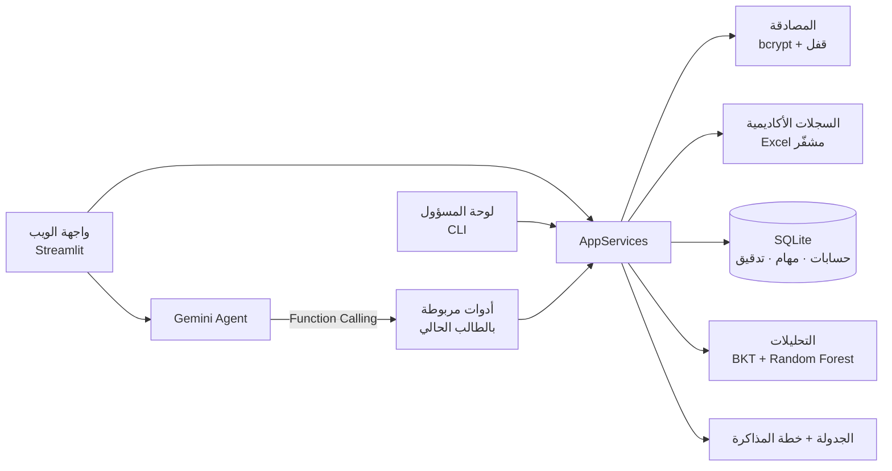

# AgentForStudent 🎓🤖

[](https://github.com/barvlk/AgentForStudent/actions/workflows/tests.yml)


[](LICENSE)

مساعد أكاديمي ذكي لطلاب جامعة أم القرى. يحلل السجل الأكاديمي للطالب، ويقدّر مستوى إتقانه لكل مجال، ويتنبأ بخطر التعثر، ويرتب مهامه، ويبني له خطة مذاكرة أسبوعية، ويحاوره عبر وكيل ذكي (Google Gemini) يستخدم أدوات حقيقية.

> An intelligent academic assistant: Bayesian Knowledge Tracing + Random-Forest risk prediction + a tool-using Gemini agent, behind an authenticated, encrypted Streamlit portal.

## لقطات من النظام

> اللقطات من بيانات تجريبية اصطناعية (أسماء ودرجات وهمية).

| لوحة الأداء: الإتقان وخطر التعثر | ترتيب المهام حسب الأولوية |
|---|---|
|  |  |
| **المساعد الذكي** | **تسجيل الدخول** |
|  |  |

## المزايا

| المجال | الميزة |
|---|---|
| 🧠 التحليلات | تتبع الإتقان بـ **BKT**، والتنبؤ بالتعثر بـ **Random Forest** مع تقييم حقيقي (ROC-AUC ≈ 0.78) |
| 🤖 الوكيل | **Gemini Function Calling** بخمس أدوات: البحث في المذكرات، المهام، التحليلات، خطة المذاكرة، الحاسبة الآمنة |
| 📅 المهام | إضافة وإنهاء وحذف المهام، وترتيبها حسب الأهمية وقرب الموعد مع **SJF** عند التساوي |
| 🔒 الأمان | تشفير البيانات بـ **Fernet (AES + HMAC)**، كلمات مرور **bcrypt**، قفل الحساب، انتهاء الجلسة، سجل تدقيق |
| 🛡️ الحماية | منع XSS و SQL Injection و Prompt Injection، وأدوات مربوطة بالطالب المسجّل فقط |
| ✅ الجودة | 55 اختبار آلي (pytest) تعمل تلقائياً على GitHub Actions، هيكل طبقات واضح، سجلات UTF-8 مع إخفاء البيانات الحساسة |

## المعمارية



## هيكل المشروع

```
├── app.py                     # تشغيل واجهة الويب
├── main.py                    # تشغيل لوحة تحكم المسؤول
├── agentforstudent/
│   ├── config.py              # الإعدادات من .env
│   ├── logging_setup.py       # السجلات + إخفاء البيانات الحساسة
│   ├── security/              # crypto.py · auth.py · masking.py
│   ├── data/                  # academic_records.py · tasks_repository.py · database.py
│   ├── analytics/             # bkt.py · risk_model.py
│   ├── agent/                 # llm.py · tools.py · knowledge_base.py · scheduler.py · study_planner.py · safe_calc.py · services.py
│   ├── ui/                    # app.py · styles.py
│   └── cli.py
├── tests/                     # اختبارات pytest
├── docs/IMPROVEMENTS.md       # شرح كل التحسينات وأسبابها
└── data/                      # البيانات المشفّرة وقاعدة البيانات (غير مرفوعة على git)
```

## التشغيل السريع (ببيانات تجريبية)

```bash
git clone https://github.com/barvlk/AgentForStudent.git
cd AgentForStudent
python -m venv .venv
.venv\Scripts\activate           # ويندوز  (لينكس/ماك: source .venv/bin/activate)
pip install -r requirements-dev.txt

python main.py setup --demo      # يولّد 100 طالب وهمي، مفتاح تشفير، ويشفّر البيانات وينشئ الحسابات
python main.py web               # أو: streamlit run app.py
```

افتح `data/initial_credentials.csv` وخذ أي رقم جامعي مع كلمة مروره المؤقتة.
للمحادثة الذكية أضف `GEMINI_API_KEY` في ملف `.env`. أما باقي المزايا فتعمل بدونه.

## التشغيل ببيانات حقيقية

```bash
# ضع ملف الطلاب في data/raw/students_by_term_150.xlsx (وملف المهام اختيارياً في data/raw/tasks.xlsx)
python main.py setup
# أو حدد المسارات:  python main.py setup --students path/to/students.xlsx --tasks path/to/tasks.xlsx
```

أعمدة ملف الطلاب المطلوبة: `الرقم الجامعي، اسم الطالب، المستوى الدراسي الحالي، ترم المادة، رمز المقرر، اسم المقرر، الساعات، الدرجة، التقدير، النقاط`.

ينشئ أمر `setup` الملف `data/initial_credentials.csv` وفيه كلمات مرور مؤقتة للطلاب، ويُطلب من كل طالب تغيير كلمة مروره عند أول دخول. **احذف هذا الملف بعد توزيع كلمات المرور.**

## النشر على Streamlit Community Cloud

1. ادخل [share.streamlit.io](https://share.streamlit.io) بحساب GitHub.
2. **Create app** ← اختر المستودع `barvlk/AgentForStudent`، الفرع `main`، والملف `app.py`.
3. من **Advanced settings** اختر Python 3.12، والصق في **Secrets**:

```toml
GEMINI_API_KEY = "مفتاحك"
DATA_ENCRYPTION_KEY = "ناتج: python main.py keygen"
AFS_PUBLIC_DEMO = "true"
AFS_DEMO_STUDENT_ID = "446006609"
AFS_DEMO_PASSWORD = "1234567"
AFS_DEMO_NAME = "عبدالمجيد"
```

في وضع العرض العام يولّد النظام بيانات وهمية مشفّرة عند أول تشغيل، ويعرض بيانات الحساب التجريبي في صفحة الدخول.
**لا ترفع بيانات طلاب حقيقية على النسخة العامة.**

## أوامر لوحة التحكم

| الأمر | الوظيفة |
|---|---|
| `python main.py` | القائمة التفاعلية |
| `python main.py setup --demo` | تهيئة كاملة على بيانات تجريبية |
| `python main.py student 441126225 --export report.txt` | ملخص وتحليل طالب |
| `python main.py train` | تقييم نموذج التنبؤ وأهمية الخصائص |
| `python main.py users set-password <id> [--temporary]` | ضبط كلمة مرور طالب |
| `python main.py users unlock <id>` | فك قفل حساب |
| `python main.py import-tasks file.xlsx` | استيراد مهام |
| `python main.py backup` | نسخة احتياطية مضغوطة ومشفّرة |
| `python main.py audit` · `logs` · `diag` | سجل التدقيق، سجلات النظام، التشخيص |
| `python main.py encrypt` / `decrypt` / `keygen` | إدارة التشفير |
| `python main.py chat <id>` | محادثة تجريبية مع الوكيل من الطرفية |

## الاختبارات

```bash
python -m pytest -q
```

## المؤلف

عبدالمجيد — قسم الذكاء الاصطناعي، جامعة أم القرى (مشروع تخرج).

## الترخيص

[MIT](LICENSE)
